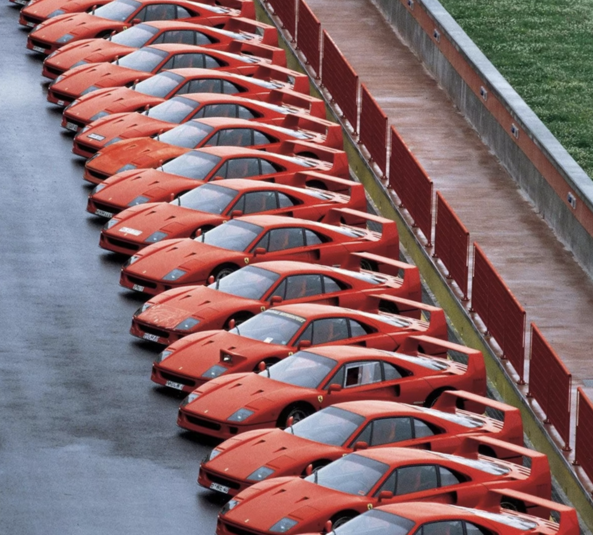
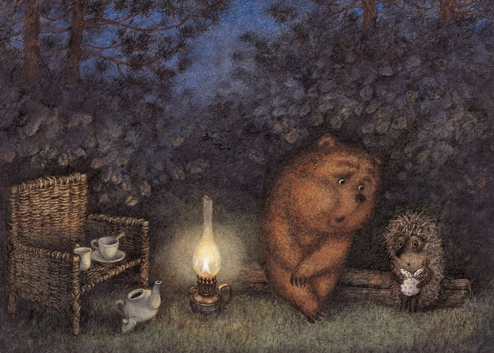

# Голосовой ассистент по картинке

Whisper - распознаёт вопрос 

Qwen3-VL - отвечает по картинке

Silero - озвучивает ответ

## Модели

| Этап | Модель | Настройки |
|---|---|---|
| Распознавание речи | Whisper small | CPU, русский язык, перед распознаванием убирается шум (noisereduce) |
| Ответ по картинке | Qwen3-VL-4B-Instruct | fp16, MPS, картинка уменьшается до 1 Мп (~1000 токенов) |
| Синтез речи | Silero v5_5_ru | голос kseniya, 48 кГц |

Модели запускаются на Mac M1 Pro с 32 ГБ памяти.

Модель получает системный промпт: она голосовой ассистент и отвечает не больше чем двумя-тремя предложениями, без списков и markdown.

## Данные

Пять пар «картинка + аудиовопрос» в [data/examples.csv](data/examples.csv). Вопросы озвучены через edge-tts мужским голосом.

| Картинка | Вопрос |
|---|---|
| cars | Найди синюю машину? |
| cartoon | Что ты видишь? |
| city | Что это за город? |
| find_cat | Где кот? |
| food | Что самое калорийное изображено здесь? |

## Интерфейс

Пустой интерфейс:


Загружены картинка и вопрос:


## Скорость работы

Время каждого этапа на Mac M1 Pro, в секундах.

### До оптимизации

Qwen3-VL в 4-битном квантовании bitsandbytes, картинки в исходном разрешении.

| Картинка | Вопрос | Ответ | ASR | VLM | TTS | Всего |
|---|---|---|---|---|---|---|
| [](data/pictures/cars.png) | Найди синюю машину. | На картинке нет синих машин. Всё — красное. | 2.1 | 247.0 | 0.5 | 249.5 |
| [](data/pictures/cartoon.png) | Что ты видишь? | Медведь и еж сидят под лампой. Рядом — плетёная стулья и чайная посуда. Сцена в лесу, вечернее время. | 2.7 | 384.2 | 1.9 | 388.7 |
| [](data/pictures/city.png) | Что это за город? | Это Париж. На фото виден Эйфелева башня, Сен-Марсельский мост и характерные парижские здания. | 2.5 | 526.7 | 2.0 | 531.2 |
| [](data/pictures/find_cat.png) | Где кот? | Кот в плетёной корзине рядом с камином. | 1.7 | 54.6 | 0.1 | 56.4 |
| [](data/pictures/food.png) | Что самое калорийное изображено здесь? | Самое калорийное — это картофель фри и печенье. | 4.4 | 788.7 | 0.5 | 793.6 |
| | | **Среднее** | **2.7** | **400.2** | **1.0** | **403.9** |

От вопроса до голосового ответа проходит от 1 до 13 минут, в среднем около 7 минут. Самый долгий этап — VLM: на него приходится 99% времени. Распознавание и синтез речи вместе занимают 1–5 секунд.

### Что изменено

1. **Модель теперь загружается в fp16 без 4-битного квантования.** На моём Mac bitsandbytes работает без ускорения: перед каждым следующим словом ответа он заново распаковывает все веса модели. Поэтому квантование не ускоряло, а замедляло ответ. Памяти мне хватает и без него: модель в fp16 занимает около 9 ГБ из 32.
2. **Картинка уменьшается до 1 мегапикселя.** Раньше картинки шли в модель целиком и превращались в 3000 токенов. В fp16 на таких картинках модели не хватало памяти. Теперь любая картинка даёт около 1000 токенов.

### После оптимизации

| Картинка | Вопрос | Ответ | ASR | VLM | TTS | Всего |
|---|---|---|---|---|---|---|
| cars | Найди синюю машину. | Синих машин на картинке нет. Все автомобили красные. | 2.7 | 22.1 | 1.8 | 26.6 |
| cartoon | Что ты видишь? | Я вижу медведя и ежика, сидящих под лампой в лесу. У них на столе чай и чайник. | 1.6 | 13.0 | 0.1 | 14.7 |
| city | Что это за город? | Это Париж. На фото виден Эйфелев столб и Сен-Марсельский мост. | 1.6 | 12.1 | 0.1 | 13.8 |
| find_cat | Где кот? | Кот спит в корзине у каминной стены. | 1.6 | 13.4 | 0.1 | 15.1 |
| food | Что самое калорийное изображено здесь? | Самое калорийное — это картофель фри с соусом. | 1.8 | 10.9 | 0.1 | 12.8 |
| | | **Среднее** | **1.9** | **14.3** | **0.4** | **16.6** |

VLM стала быстрее примерно в 28 раз: 14 секунд вместо 400. От вопроса до голосового ответа теперь проходит 13–27 секунд, в среднем около 17 секунд вместо 7 минут. Первый запрос (cars) дольше остальных. Ответы по смыслу остались такими же.

## Шум в аудио

сильный шум - SNR 0 дБ, шум такой же громкий, как голос
очень сильный - SNR −5 дБ, шум громче голоса

| Картинка | Исходный вопрос | Шум | Что распознал Whisper | Ответ | ASR | VLM | TTS | Всего |
|---|---|---|---|---|---|---|---|---|
| cars | Найди синюю машину? | сильный | Найди синий машин. | На картинке нет синих машин. Все автомобили красные. | 2.3 | 18.5 | 0.6 | 21.3 |
| cars | Найди синюю машину? | очень сильный | Найди сильную машину! | На фото — красные Ferrari F40, одна из самых мощных моделей марки. Они выстроены в ряд, готовы к гонке. | 8.5 | 18.7 | 0.1 | 27.3 |
| city | Что это за город? | сильный | Что это за гора? | На фото нет горы. Это Париж, город в Франции, с Эйфелевой башней и рекой Сен-Марен. | 1.9 | 18.2 | 0.1 | 20.2 |
| city | Что это за город? | очень сильный | Ты это забыл? | Нет, я не забыл. Я здесь, чтобы помочь. | 2.1 | 15.2 | 0.1 | 17.4 |
| find_cat | Где кот? | сильный | Где кот? | Кот спит в корзине у каминной стены. | 1.6 | 17.6 | 0.1 | 19.3 |
| find_cat | Где кот? | очень сильный | Где кот? | Кот спит в корзине у каминной стены. | 2.3 | 14.2 | 0.1 | 16.5 |

## Мелкие детали на картинке

Чтобы проверить мелкие детали, я спрашиваю, сколько вишен на картинке с едой. Вишни маленькие и разбросаны по разным углам: две сверху и две снизу.

| Картинка | Вопрос | Ответ | Правильно | ASR | VLM | TTS | Всего |
|---|---|---|---|---|---|---|---|
| [](data/pictures/food.png) | Сколько вишен на этой картине изображено? | На картинке изображено три вишни. | 4 | 2.3 | 13.5 | 0.1 | 15.9 |

Модель ошиблась: насчитала три вишни вместо четырёх. Она понимает, что на картинке вишни, но с подсчётом мелких предметов справляется плохо. Возможно, мешает и то, что картинка уменьшается до 1 мегапикселя: вишни становятся ещё меньше.

## Вывод

**К реальному использованию ассистент не готов.**

- Ответ приходит долго: через 13–27 секунд
- При сильном шуме Whisper искажает вопрос, и ассистент отвечает на другой вопрос
- Мелкие предметы модель считает с ошибками

**Что изменить, чтобы ассистент отвечал быстрее:**

1. **Потоковый режим.** Озвучивать ответ по предложениям, пока модель ещё пишет его дальше
2. **Модели легче.** Например, Qwen3-VL-2B вместо 4B и Whisper base вместо small
3. **Картинки меньше.** Меньше токенов — быстрее ответ, но мелкие детали будут теряться ещё сильнее

Против шума можно переспрашивать пользователя, если Whisper не уверен в распознанном вопросе.

## Запуск

Нужны `uv` и Mac с Apple Silicon. Команды выполняются из папки проекта.

Установить зависимости:

```bash
uv sync
```

Запустить интерфейс:

```bash
uv run python -m audio_ai.app
```

Интерфейс откроется по адресу http://127.0.0.1:7860.
